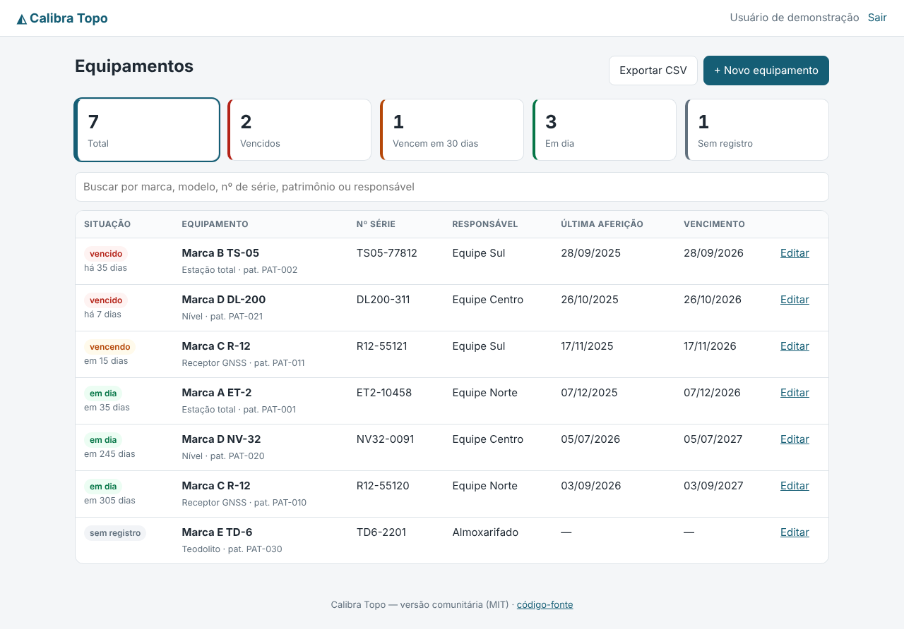
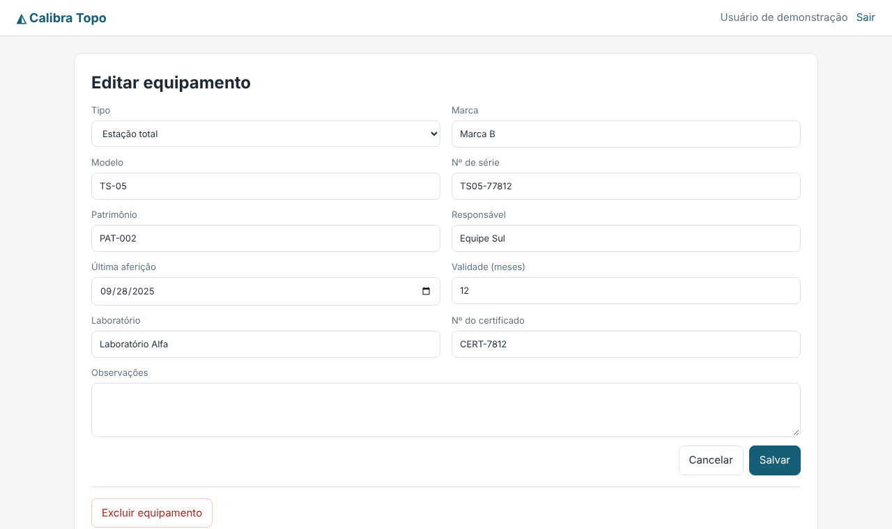

# Calibra Topo

[](https://github.com/maessa-oliveira/calibra-topo/actions/workflows/ci.yml)
[](LICENSE)

**Seu equipamento está com a aferição em dia?** Sistema web para controlar a aferição/calibração de
estações totais, receptores GNSS, níveis e teodolitos: painel com o que está **vencido**, **vencendo em
30 dias** e **em dia**, cadastro com laboratório e certificado, busca, exportação CSV e uma API de alertas.

> Versão comunitária, simples e de código aberto. 🇬🇧 *Web app to track calibration due dates of
> surveying instruments (total stations, GNSS receivers, levels). FastAPI + SQLAlchemy + Jinja, with
> auth, per-user data isolation, CSRF protection, tests and Docker.*



## Funcionalidades

- Login e cadastro (senha com PBKDF2-SHA256, 310 mil iterações), sessão assinada e proteção CSRF.
- Cada usuário só vê os próprios equipamentos (testado).
- Situação calculada a partir da última aferição + validade em meses (com tratamento de fim de mês).
- Indicadores clicáveis, busca por marca/modelo/série/patrimônio/responsável.
- Exportação **CSV** (abre direto no Excel) e **API JSON** `/api/alertas` para automações (e-mail, WhatsApp, planilhas).



## Rodando

```bash
pip install -r requirements.txt
python -m app.exemplo          # opcional: dados FICTÍCIOS (demo@exemplo.com / demonstracao)
uvicorn app.main:app --reload  # http://localhost:8000
```

Com Docker:

```bash
docker build -t calibra-topo .
docker run -p 8000:8000 -e CALIBRA_SECRET=$(openssl rand -hex 32) -v calibra:/dados calibra-topo
```

| Variável | Para quê |
|---|---|
| `CALIBRA_DB` | URL do banco (padrão SQLite `./calibra.db`; aceita PostgreSQL) |
| `CALIBRA_SECRET` | chave das sessões — **obrigatória em produção** |
| `CALIBRA_HTTPS` | `1` para cookie só em HTTPS |

## Arquitetura

```
app/
  models.py   regras de negócio (situação, vencimento, hash de senha)
  db.py       SQLAlchemy 2.0
  main.py     rotas FastAPI, autenticação, CSRF, CSV e API
  templates/  Jinja2 (HTML renderizado no servidor, sem framework JS)
tests/        pytest: regras, login, CSRF, CRUD, validações, isolamento entre usuários, CSV
```

## Testes

```bash
pip install -r requirements-dev.txt
pytest          # 21 testes
ruff check app tests
```

O GitHub Actions roda lint e testes em Python 3.11–3.13 e sobe o container Docker para checar `/saude`.

## Roadmap

- [ ] Envio automático de lembrete por e-mail
- [ ] Anexar o PDF do certificado
- [ ] Histórico de aferições por equipamento

## Autora

**Maessa Oliveira** — agrimensora e projetista, graduanda em Engenharia de Software.
[LinkedIn](https://www.linkedin.com/in/maessa-oliveira/) · Licença [MIT](LICENSE).

## English

**Calibration tracking for surveying equipment** (total stations, GNSS receivers, levels):
due/overdue alerts, certificate history, CSV export, per-user data isolation, session auth with CSRF
protection. Built with FastAPI, SQLAlchemy 2 and Jinja; automated tests and Docker image included.
